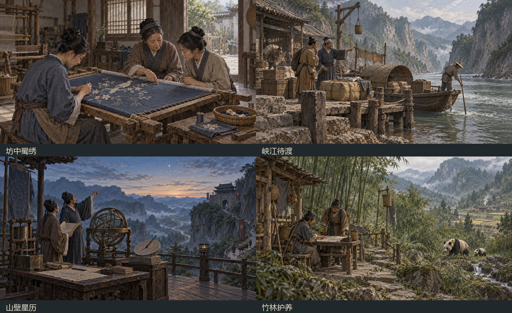

# 静态加载图与事件中段插图（0.3.1）

## 加载图

按最后确认取消视差分层，使用四张完整静态画面。第四张由「雨后坡田」替换为「竹林护养」。

| 主题 | 已有绘画来源 | 加载资源 |
| --- | --- | --- |
| 坊中蜀绣 | `assets/event_expansion/craft.png` | `craft_metadata_os3840x2160_d0x0.dds` |
| 峡江待渡 | `assets/event_expansion/river.png` | `river_metadata_os3840x2160_d0x0.dds` |
| 山壁星历 | `assets/event_expansion/observatory.png` | `observatory_metadata_os3840x2160_d0x0.dds` |
| 竹林护养 | `assets/event_endings_v031/panda_sanctuary.png` | `panda_sanctuary_metadata_os3840x2160_d0x0.dds` |

四张均导出为原版 3840×2160、16:9、BC3/DXT5 DDS，完整不透明，保留原绘画风格。原图按比例适配后使用 Lanczos 重采样到原版画布；这不会凭空增加绘画细节。资源合计约 33 MB，没有 PSD 或未采用的视差层进入模组。

使用原版 `loading_screen_scene_` 场景注册、`ecs_illustration_image`、原版 16:9 后层 `layer_8_mesh`、静态 `illustration_override` 绑定和原版摄影机参数。每个场景只有一个画面平面，没有 `_anims` 绑定、UV 漂移或前中后三层。没有覆盖 `loading_screen.gui`；画框、进度条和提示位置沿用原版。



## 历史摘句

通过原版 `GetLoadingScreenLoadTip` 和已有 `LOADING_TIP_0` 至 `LOADING_TIP_3` 提示槽展示，保留其余原版提示。摘句随原版提示轮换，不与特定图片绑定。简体中文保留原文，英文为本模组译文，均附署名与篇名。

| 摘句 | 作者、篇名与核对来源 |
| --- | --- |
| 晓看红湿处，花重锦官城。 | [杜甫《春夜喜雨》](https://zh.wikisource.org/zh-hans/春夜喜雨) |
| 朝辞白帝彩云间，千里江陵一日还。 | [李白《早发白帝城》](https://zh.wikisource.org/zh-hans/早發白帝城) |
| 此身合是诗人未？细雨骑驴入剑门。 | [陆游《剑门道中遇微雨》](https://zh.wikisource.org/zh-hans/劍門道中遇微雨) |
| 时无荒年，天下谓之天府。 | [《华阳国志》卷三·蜀志，引《蜀记》](https://zh.wikisource.org/zh-hans/華陽國志/卷三) |

来源核对日期：2026-10-15。诗文只出现在原版提示区域，不烘焙到绘画内。

## 事件中段插图

事件差分图继续保留：7 条地区长线从第 3 章、33 条短链从第 2 章、移民长线从第 4 章开始，根据此前选择切换已有分支画面，共 115 个阶段事件。

地区长线使用既有路线倾向，移民线使用既有接纳倾向；倾向为零或变量尚未设置时回退到原图。短链在前两章的 A/B/C 选项中记录隐藏的展示变量，下一章据此选择画面；旧存档尚无展示变量时保留原图。所有变量比较先检查变量存在。

原有结局回顾画面保留。本次没有改变任何费用、奖励、惩罚、事件条件、等待时间或结局流转。浏览器提供「差分预览（实机按此前选择显示）」下拉框，用于查看各候选图和旧存档回退图。

## 构建与验证

`tools/build_mod.py` 在结局插图和逻辑修复后依次调用 `apply_progress_art_v031.py`、历史指南、`apply_loading_art_v031.py`，生成登记、纹理、报告与清单哈希。

针对性验证：

```powershell
python tools/validate_presentation_art_v031.py --report docs/testing/presentation-art-static-v031.json
```

验证包括相对于补丁前提交 `df5c2c6` 的事件脚本 token 比对（忽略插图标签和本次展示标记）、旧存档回退、资源路径、纹理尺寸/透明度/哈希、原生提示槽及浏览器目录。完整重建的 27 个相关运行时文件与安装源逐字节相同。

最终结构检查、原生引擎探针及其范围限制记录于 `docs/testing/presentation-art-final-v031.json`。无渲染模式的原生探针不能代替逐张加载画面的游戏内视觉验收。
