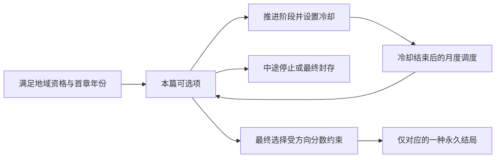

# 0.3.1 事件链逻辑核查

本轮以 951256b 的结局插图补丁为基线，核查七条地区长线、一条共同移民长线和三十三条短链，共 41 条。原有会盟、府议与国家事件同时接受全模组引用检查。此次修复只涉及剧情承接、阶段守卫、结局互斥与展示记录，未改动原有选项的奖惩、费用和可选条件。

## 已修复的问题

| 事件链 | 原先的承接问题 | 修复 |
| --- | --- | --- |
| 岸边的旧船坞 | 暂缓搬迁后，下一篇仍说工具已搬到新址；承包后又默认答应共用 | 改成清点旧工具、讨论后续排期，不代替玩家决定搬迁或共用 |
| 新来的船工 | 拒绝试船后仍默认已经随船；公开考试的回顾直接宣布已获名额 | 区分修船短工、临时试用与正式入帮；回顾只承诺公平应试的机会 |
| 湖广填四川 | 只准过境后，次章直接写已安置；末章默认所有人曾获居留 | 首章记录三种裁定，次章按收户、担保、过境显示不同开场；末章兼容各种旧凭记 |
| 合开的染坊 | 配方留在合坊后，下一篇却默认已分出两坊 | 改为两位师傅争收徒，兼容合坊及分坊 |
| 一间新药铺 | 不准独立行医后，仍默认新铺已获固定病家 | 后续基于会诊和查方的经历，正式铺号到末篇再裁定 |
| 迁来的祭日 | 坚持旧役日后，仍写成已调役 | 区分临时裁定与来年制度化议题 |
| 山寨门前的铁门 | 维护寨主独供约后，默认已建公仓 | 以存有住户寄粮的寨仓展开钥匙争议 |
| 议事时的座次 | 已准青年入席后，仍写他永远被挡在门外 | 改为担忧后来者的发言资格 |
| 酒瓮、茶砖、借种、歇脚屋 | 恢复旧做法后默认采用新法，或固定按春季承接相对月份 | 把新法作为下一次提案；移除无法由固定间隔保证的季节前提 |
| 竹林中的白熊 | 放归后仍说幼兽留在坡地；未订保护约也说已订；未划界却说划过界 | 使用发现地、原有山契、现有供养办法，不虚构先前的玩家决定 |
| 渡口的两个孩子 | 训练护工的回顾额外宣称禁止孩子做工 | 回顾只落实照料责任，不暗加选项未包含的政策 |

## 顺序与结局守卫

- 地区长线和移民长线的事件自身也检查冷却；地区首章自身检查开篇年份。此前主要由月度调度器保证这些条件。
- 地区永久结局必须处于第八章完成状态、未放弃，且与实际选中的结局一致。旧存档未记录所选分支时，以原有方向分数作兼容判断。
- 最终封存选项明确记录放弃，不能取得永久结局；中途停止保留既有短期效果，停止后续投入。
- 短链第二、三篇要求确实见过首篇，并保留阶段、冷却与等待标记约束。
- 结局回顾按整条链互斥。同一链不会因重复投递或另一路回调出现第二种互相矛盾的回顾。旧的单分支已读标记同样有效。
- 以上是对边界条件的加固，不表示此前正常月度调度必然会越序；原先发现的实际前后矛盾主要在叙事承接。

## 地区长线总表

各链八篇，前七篇选择方向分数依次为 a:+2、b:+1、c:-2；第八篇按累计分数开放两个正式结局之一，或选择封存。正常选择及时、资格持续有效时，从本国首章起约 45–46 年完成。

| 地区 | 事件链 / 首章最早年份 | 事件前缀 | 分数非负结局 | 分数为负结局 |
| --- | --- | --- | --- | --- |
| 成都平原 | 竹林中的白熊 / 1340 | `hbe_story_chengdu_plain.1–8` | 山林护兽约（`.201`） | 锦城瑞兽馆（`.202`） |
| 川南盐酒 | 井下巨骨 / 1344 | `hbe_story_southern_salt_wine.1–8` | 巨骨公藏与井谱（`.201`） | 盐城龙骨陈馆（`.202`） |
| 川东江运 | 峡江引水谱 / 1341 | `hbe_story_eastern_river.1–8` | 百滩共用船约（`.201`） | 川江护航总署（`.202`） |
| 川北蜀道 | 山壁上的星历 / 1340 | `hbe_story_northern_shudao.1–8` | 山地测候公课（`.201`） | 关军传时网（`.202`） |
| 川中丘陵 | 坡田与水土 / 1342 | `hbe_story_central_hills.1–8` | 坡田共护章程（`.201`） | 坡田统一田册（`.202`） |
| 川西茶马 | 山路上的医马人 / 1343 | `hbe_story_western_tea_horse.1–8` | 茶路医马学舍（`.201`） | 良马官苑（`.202`） |
| 西南山谷 | 谷中桥约 / 1345 | `hbe_story_southwestern_valleys.1–8` | 诸谷共桥约（`.201`） | 关桥总署（`.202`） |

所有地区长线相对时间点为：0、4、9、15、22、29、37、45 年。读档、改国号不会主动清除阶段变量；资格不符时暂停，恢复资格后继续。`hbe_is_prince` 依历史国家标识和首都位于 HBE 地域判定，并不等同于必须仍在帝国组织内。

## 共同移民长线

“湖广填四川”最早 1345 年开篇，各国独立保存进度。十篇相对时间点为 0、5、10、16、22、28、34、39、44、49 年，正常约 49–50 年收束。前九篇接纳分数为 a:+2、b:+1、c:-1。末篇累计至少 6 分可立“新乡共籍约”，低于 6 分可立“旧户担保制”，也可不立永久章程。拒绝一批人入境不会永久锁死后续讨论；新的来客仍可能请求重议。

| 篇次 | 标题 | 相对首篇年份 |
| --- | --- | --- |
| 1 | 峡口来的船 | 0 |
| 2 | 一块尚未开出的田 | 5 |
| 3 | 同姓而不同乡 | 10 |
| 4 | 新渠末端的村落 | 16 |
| 5 | 外乡师傅的工牌 | 22 |
| 6 | 仓门前的新旧户 | 28 |
| 7 | 同一条路上的两种话 | 34 |
| 8 | 留下还是再走 | 39 |
| 9 | 新祠与旧桥之间 | 44 |
| 10 | 户册里的下一代 | 49 |

旧存档未记录首篇选择时，次章使用不预设收户结果的通用开场。新记录不会补发资源或改算已有接纳分数。

## 三十三条短链

每条三篇，第一到第二篇至少六个月，第二到第三篇至少十二个月；由下一次月度调度投递。各篇均可停止。完成第三篇的 a/b/c 后隔一日出现对应回顾，回顾只有确认按钮，不再发奖；停止选项不出现成功回顾。下表列出第三篇的三种安排。

| 地区 | 事件链 | 事件编号 | a / b / c 收尾安排 |
| --- | --- | --- | --- |
| 成都平原 | 失色的锦样 | `hbe_short_chengdu_plain.1–3` | 公开验色，允许新坊接单。 / 由旧行会作保，维持稳定交货。 / 在府学留样，按用途分发订单。 |
| 成都平原 | 借来的诗卷 | `hbe_short_chengdu_plain.11–13` | 供公共讲读，留穷户席位。 / 准主人邀客，以礼物补修屋。 / 让书坊办读本，馆中按日限客。 |
| 成都平原 | 竹山的两张界图 | `hbe_short_chengdu_plain.21–23` | 按季议价，由两村共管。 / 固定官价，换取长期订单。 / 准作坊预订，公开轮伐记录。 |
| 川南盐酒 | 盐灶上的新铜管 | `hbe_short_southern_salt_wine.1–3` | 给转学煎盐的名额。 / 付一次工钱，准井主自定雇用。 / 让盐署雇他们巡查各井管道。 |
| 川南盐酒 | 顺流而下的酒瓮 | `hbe_short_southern_salt_wine.11–13` | 并刻烧造与装载记号。 / 由商铺统一担保。 / 设公用验瓮，让新窑也能供货。 |
| 川南盐酒 | 井旁的旧墓 | `hbe_short_southern_salt_wine.21–23` | 留原处石记，准村民祭礼。 / 移碑村口，以盐利供养。 / 府学留图，公布开井时的约定。 |
| 川东江运 | 夜里听不见的江号 | `hbe_short_eastern_river.1–3` | 公开夜行办法，准船帮自查。 / 纳入军用护航，按券放行。 / 交码头讲习，收费只补灯油。 |
| 川东江运 | 岸边的旧船坞 | `hbe_short_eastern_river.11–13` | 保留小船时段，补短期误工。 / 大船优先，以货利付渔户工钱。 / 按船型公开排期，设共同账房。 |
| 川东江运 | 峡中留下的拓本 | `hbe_short_eastern_river.21–23` | 供木搭棚，留石在原处。 / 迁入陈馆，补村寨运输钱。 / 保存拓本，停止扩大石面开凿。 |
| 川北蜀道 | 驿站里的沙漏 | `hbe_short_northern_shudao.1–3` | 公开器具改法，隐去守军行期。 / 把更册全交关军，军用优先。 / 供府学教读，另记城门军册。 |
| 川北蜀道 | 轮戍人的两册工钱 | `hbe_short_northern_shudao.11–13` | 按实日计役，府库供替岗。 / 集中供养关军，稳定值守。 / 村寨共议轮值，每季公开工钱。 |
| 川北蜀道 | 山路上的书箱 | `hbe_short_northern_shudao.21–23` | 按供学用量发券，公开采购。 / 关署统一采办，控制免关。 / 书坊与府学共同订货，逐年查账。 |
| 川中丘陵 | 仓中的两种谷子 | `hbe_short_central_hills.1–3` | 设公共留种，不按出资限借。 / 出资者优先，限定借种价格。 / 由仓户推举查种人，公开库存。 |
| 川中丘陵 | 寄来的种桑信 | `hbe_short_central_hills.11–13` | 准寄册互学，资助抄印。 / 限本府传习，保护订单。 / 以商人往来交换新种记录。 |
| 川中丘陵 | 桥边的债簿 | `hbe_short_central_hills.21–23` | 按受益分摊，公开借还记录。 / 保留商人垫款，府署定期担保。 / 减小工程，乡里自行维护。 |
| 川西茶马 | 被雨打湿的茶砖 | `hbe_short_western_tea_horse.1–3` | 公开包装做法，资助传习。 / 保护限期独供，稳定交割。 / 设公用货样，让买主按路程选择。 |
| 川西茶马 | 马群中的旧烙印 | `hbe_short_western_tea_horse.11–13` | 训练牧人共同验马。 / 保留旧验牌，重申担保。 / 医马舍留病历，市契另记买卖。 |
| 川西茶马 | 雪路上的歇脚屋 | `hbe_short_western_tea_horse.21–23` | 村寨养屋，保留冬行救助。 / 交军路长期驻守。 / 准屋旁交易，以货费修顶。 |
| 西南山谷 | 湖上两家的渔船 | `hbe_short_southwestern_valleys.1–3` | 共记渡人和运货，按时段调船。 / 只保证货约，村寨另雇渡船。 / 让两家轮派船工，府署每季查账。 |
| 西南山谷 | 山寨门前的铁门 | `hbe_short_southwestern_valleys.11–13` | 按契查欠，先放还种粮。 / 认可旧租，给穷户短期口粮。 / 重新订公仓规则，不许私锁借粮。 |
| 西南山谷 | 议事时的座次 | `hbe_short_southwestern_valleys.21–23` | 按记录能力推举并传习。 / 承认旧席传承，限定职责。 / 各寨轮派译写，保留共同查账。 |
| 全境共享 | 第一口乡音 | `hbe_short_shared.1–3` | 保留各自风味，公开验食。 / 纳入旧行会，统一价目。 / 按卫生与成色发长期摊牌。 |
| 全境共享 | 借住的院落 | `hbe_short_shared.11–13` | 按居住记录给门牌。 / 只认买屋，乡议仍由旧户主持。 / 以修路出资取得共同见证。 |
| 全境共享 | 渡口的两个孩子 | `hbe_short_shared.21–23` | 明定责任，训练护工。 / 给一次补偿，维持旧雇用。 / 药舍定期查伤，船帮分担费用。 |
| 全境共享 | 由谁教孩子读书 | `hbe_short_shared.31–33` | 按教学成绩聘任。 / 保留旧家主持，明列公共名额。 / 由住户轮选教读，公账供纸墨。 |
| 全境共享 | 迁来的祭日 | `hbe_short_shared.41–43` | 承认礼期，按季调役。 / 保留逐案宽免，维护领役。 / 设付酬替役，让乡里自行筹工。 |
| 全境共享 | 一间新药铺 | `hbe_short_shared.51–53` | 承认独立铺号，公开查方。 / 合入旧药铺，维持行规。 / 设共同药舍，给两医固定酬钱。 |
| 全境共享 | 荒地上的借种 | `hbe_short_shared.61–63` | 按发芽与收成验还。 / 按原种验还，保护仓册。 / 分仓保存，教住户共同记种。 |
| 全境共享 | 合开的染坊 | `hbe_short_shared.71–73` | 准轮随两师传习，明定工钱。 / 一师一徒，维护行规。 / 设共同试染课，以技艺分工。 |
| 全境共享 | 同住一坡的山民 | `hbe_short_shared.81–83` | 木牌记双名，认可共同见证。 / 只用官名，维持地册。 / 官册附旧名，教两方核对。 |
| 全境共享 | 递到府署的合姓诉状 | `hbe_short_shared.91–93` | 按使用与出资共同推举。 / 保留旧名额，定期公开账本。 / 府署收管，统一路费。 |
| 全境共享 | 新来的船工 | `hbe_short_shared.101–103` | 准入帮，保留旧师承。 / 按旧规入帮，维护船帮体面。 / 设公开试船，不按籍贯择人。 |
| 全境共享 | 返回旧乡的长者 | `hbe_short_shared.111–113` | 准自购祭田，承认本府住户。 / 保留旧族公地，按旧乡祭扫。 / 设共同纪念，不另分族田。 |

## 验证结果及边界

- 正式运行目录 1930 项结构/引用/路径检查通过；隔离完整重建目录 1928 项通过（运行目录另有两项既存兼容文件检查）。
- 解析实际生成脚本，穷举 15,309 条地区完成路径、19,683 条移民完成路径、891 条短链完成路径，并检查 45,316 个中止状态、120 个月度调度边界、101 种回顾互斥。完成路径按有能力支付所选费用计，另对零金币状态验证至少存在一个可用选项。
- 隔离两个月无界面游戏夹具 477 项检查通过，其中包括 273 个原生状态断言、101 个回顾已读及 101 个等待标记清除检查。两种地区永久结局均在对应国家实际执行。
- 21 个生成文件与完整重建、引擎实际测试副本的脚本/本地化 token 相同；连续两次导出完全幂等。
- 16 个原有事件文件的所有选项，剔除有明确边界的顺序记录和展示块后，与基线奖励、费用及条件 token 完全相同。
- 本地浏览器 7 项测试通过，包括新的条件描述通用文本和既有动态费用展示。
- 游戏夹具全局测试仍报告既有错误日志诊断：`Tests: / [ FAIL ] Error log: 11833 errors`。本次修改的链路脚本和测试脚本没有相关引擎错误；没有把全局测试标为全绿。
- 夹具为探测阶段而主动清除计时器，并非重新进行自然 AI 的五十年经营测试；本轮未验证渲染后的游戏 UI。
- 旧兼容孤立事件保留，不恢复为新的主动剧情。既有会盟周期和府议奖惩不在此次改写范围。

详细证据：`docs/testing/story-logic-structural-v031.json`、`story-logic-rebuild-v031.json`、`story-logic-runtime-v031.json`、`story-logic-final-v031.json`。

本轮保持版本 0.3.1，只作本地提交与本地安装；没有发布 Steam 或推送 Git 远端。
