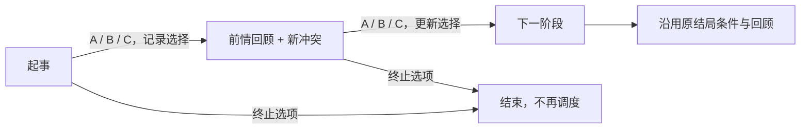

# 连续事件的前情与当前场景重写（0.3.1）

原短链生成器把完整 `context` 与每一章的新正文拼接，读到后续章时仍会重新讲述同一段起事背景。本次在最终构建中改为两段：第一章用起事背景承接当前请求；后续章先回顾上一章实际选择的结果，再展开当前新事件。

覆盖 7 条地区长线、33 条短链和 1 条移民长线，共 165 个阶段事件；124 个后续节点各有 A/B/C 三种前情与一份中性旧存档回顾，合计核对 372 个前章选项链接。14 个地区结局各自补写常设后的责任，不再使用共同收尾。

前情只追踪紧邻的上一章；地区长线与移民线原有的累计倾向仍决定最终可选结局。174 处新增隐藏记录只保存前章选择，不改金币、修正、资源、AI 权重、触发条件、冷却和终止流程。短链复用已有插图选择变量，不增重复的状态。

旧存档缺少选择变量或记录值无效时，回退到针对该阶段写的中性回顾。移民第二章继续识别旧版本已有的首批居留政策，拒绝首批入境时会回顾其继续过境，后续租地请求由另一些带担保的家庭提出。

所有正文保留两段，去掉“第几章”和“历次选择决定最后章程”等机械尾注。短链新增各自的场景细节；长线修正了不足五十年内却写成多代更替的措辞。历史悬浮词条在相应正文及条件版本中保留。英文栏沿用本批故事既有的中文回退政策，本次没有宣称完成英语文学翻译。

## 实际事件树

当前脚本按顺序推进章节，A/B/C 会合到下一阶段，D 通常终止。长线将分支倾向积累到最后一章；短链在第三章选择后触发各自的结局回顾。此次重写按现有结构承接，没有另改树的可达路径。

### 七条地区长线

八个阶段相对首章的年份为 0、4、9、15、22、29、37、45 年；结局回调沿用原等待。各阶段第一段回顾上一阶段的选项，第二段描述下面表中的当前问题。

#### 竹林中的白熊

| 事件 | 当前问题 | 前情来自 |
| --- | --- | --- |
| `hbe_story_chengdu_plain.1` | 竹林中的黑白足迹 | 起事背景 |
| `hbe_story_chengdu_plain.2` | 一只受伤的幼兽 | `hbe_story_chengdu_plain.1` 的 A/B/C |
| `hbe_story_chengdu_plain.3` | 山界上的新田 | `hbe_story_chengdu_plain.2` 的 A/B/C |
| `hbe_story_chengdu_plain.4` | 瑞兽是否应当远送 | `hbe_story_chengdu_plain.3` 的 A/B/C |
| `hbe_story_chengdu_plain.5` | 竹花之年 | `hbe_story_chengdu_plain.4` 的 A/B/C |
| `hbe_story_chengdu_plain.6` | 画册中的习性 | `hbe_story_chengdu_plain.5` 的 A/B/C |
| `hbe_story_chengdu_plain.7` | 下一代巡山人 | `hbe_story_chengdu_plain.6` 的 A/B/C |
| `hbe_story_chengdu_plain.8` | 山林与城苑的约定 | `hbe_story_chengdu_plain.7` 的 A/B/C |

结局：`hbe_story_chengdu_plain.201` 山林护兽约；`hbe_story_chengdu_plain.202` 锦城瑞兽馆。累计倾向 `hbe_story_chengdu_plain_direction` 非负走第一结局，负数走第二结局；中途终止及最终封存沿用原规则。

#### 井下巨骨

| 事件 | 当前问题 | 前情来自 |
| --- | --- | --- |
| `hbe_story_southern_salt_wine.1` | 石层里的巨骨 | 起事背景 |
| `hbe_story_southern_salt_wine.2` | 拼不回去的骨架 | `hbe_story_southern_salt_wine.1` 的 A/B/C |
| `hbe_story_southern_salt_wine.3` | 一笔龙骨药钱 | `hbe_story_southern_salt_wine.2` 的 A/B/C |
| `hbe_story_southern_salt_wine.4` | 石层的先后 | `hbe_story_southern_salt_wine.3` 的 A/B/C |
| `hbe_story_southern_salt_wine.5` | 巨兽的足印 | `hbe_story_southern_salt_wine.4` 的 A/B/C |
| `hbe_story_southern_salt_wine.6` | 龙骨与旧说 | `hbe_story_southern_salt_wine.5` 的 A/B/C |
| `hbe_story_southern_salt_wine.7` | 代代相传的井谱 | `hbe_story_southern_salt_wine.6` 的 A/B/C |
| `hbe_story_southern_salt_wine.8` | 给巨兽留下名字 | `hbe_story_southern_salt_wine.7` 的 A/B/C |

结局：`hbe_story_southern_salt_wine.201` 巨骨公藏与井谱；`hbe_story_southern_salt_wine.202` 盐城龙骨陈馆。累计倾向 `hbe_story_southern_salt_wine_direction` 非负走第一结局，负数走第二结局；中途终止及最终封存沿用原规则。

#### 峡江引水谱

| 事件 | 当前问题 | 前情来自 |
| --- | --- | --- |
| `hbe_story_eastern_river.1` | 老船夫的滩记 | 起事背景 |
| `hbe_story_eastern_river.2` | 汛期与枯水 | `hbe_story_eastern_river.1` 的 A/B/C |
| `hbe_story_eastern_river.3` | 有人冒领引水牌 | `hbe_story_eastern_river.2` 的 A/B/C |
| `hbe_story_eastern_river.4` | 峡中夜号 | `hbe_story_eastern_river.3` 的 A/B/C |
| `hbe_story_eastern_river.5` | 修船木料的去处 | `hbe_story_eastern_river.4` 的 A/B/C |
| `hbe_story_eastern_river.6` | 两府各收一遍 | `hbe_story_eastern_river.5` 的 A/B/C |
| `hbe_story_eastern_river.7` | 纸谱与新船 | `hbe_story_eastern_river.6` 的 A/B/C |
| `hbe_story_eastern_river.8` | 百滩共用的船约 | `hbe_story_eastern_river.7` 的 A/B/C |

结局：`hbe_story_eastern_river.201` 百滩共用船约；`hbe_story_eastern_river.202` 川江护航总署。累计倾向 `hbe_story_eastern_river_direction` 非负走第一结局，负数走第二结局；中途终止及最终封存沿用原规则。

#### 山壁上的星历

| 事件 | 当前问题 | 前情来自 |
| --- | --- | --- |
| `hbe_story_northern_shudao.1` | 山口的日影 | 起事背景 |
| `hbe_story_northern_shudao.2` | 阴云下的驿刻 | `hbe_story_northern_shudao.1` 的 A/B/C |
| `hbe_story_northern_shudao.3` | 一次未中的月食 | `hbe_story_northern_shudao.2` 的 A/B/C |
| `hbe_story_northern_shudao.4` | 星台建在哪里 | `hbe_story_northern_shudao.3` 的 A/B/C |
| `hbe_story_northern_shudao.5` | 送不齐的观测簿 | `hbe_story_northern_shudao.4` 的 A/B/C |
| `hbe_story_northern_shudao.6` | 异乡的仪器 | `hbe_story_northern_shudao.5` 的 A/B/C |
| `hbe_story_northern_shudao.7` | 历书换了主持者 | `hbe_story_northern_shudao.6` 的 A/B/C |
| `hbe_story_northern_shudao.8` | 山路上的同一时刻 | `hbe_story_northern_shudao.7` 的 A/B/C |

结局：`hbe_story_northern_shudao.201` 山地测候公课；`hbe_story_northern_shudao.202` 关军传时网。累计倾向 `hbe_story_northern_shudao_direction` 非负走第一结局，负数走第二结局；中途终止及最终封存沿用原规则。

#### 坡田与水土

| 事件 | 当前问题 | 前情来自 |
| --- | --- | --- |
| `hbe_story_central_hills.1` | 雨后露出的红土 | 起事背景 |
| `hbe_story_central_hills.2` | 新埂挡住旧路 | `hbe_story_central_hills.1` 的 A/B/C |
| `hbe_story_central_hills.3` | 一座小坝的归属 | `hbe_story_central_hills.2` 的 A/B/C |
| `hbe_story_central_hills.4` | 绿肥与旧收成 | `hbe_story_central_hills.3` 的 A/B/C |
| `hbe_story_central_hills.5` | 仓册中的旱年 | `hbe_story_central_hills.4` 的 A/B/C |
| `hbe_story_central_hills.6` | 坡地上的新作物 | `hbe_story_central_hills.5` 的 A/B/C |
| `hbe_story_central_hills.7` | 堤埂谁来维修 | `hbe_story_central_hills.6` 的 A/B/C |
| `hbe_story_central_hills.8` | 留给后人的坡田 | `hbe_story_central_hills.7` 的 A/B/C |

结局：`hbe_story_central_hills.201` 坡田共护章程；`hbe_story_central_hills.202` 坡田统一田册。累计倾向 `hbe_story_central_hills_direction` 非负走第一结局，负数走第二结局；中途终止及最终封存沿用原规则。

#### 山路上的医马人

| 事件 | 当前问题 | 前情来自 |
| --- | --- | --- |
| `hbe_story_western_tea_horse.1` | 走不动的驮马 | 起事背景 |
| `hbe_story_western_tea_horse.2` | 药草与马价 | `hbe_story_western_tea_horse.1` 的 A/B/C |
| `hbe_story_western_tea_horse.3` | 冬季草场 | `hbe_story_western_tea_horse.2` 的 A/B/C |
| `hbe_story_western_tea_horse.4` | 一场马疫 | `hbe_story_western_tea_horse.3` 的 A/B/C |
| `hbe_story_western_tea_horse.5` | 小马驹的去处 | `hbe_story_western_tea_horse.4` 的 A/B/C |
| `hbe_story_western_tea_horse.6` | 两种马的脚程 | `hbe_story_western_tea_horse.5` 的 A/B/C |
| `hbe_story_western_tea_horse.7` | 医马人的学生 | `hbe_story_western_tea_horse.6` 的 A/B/C |
| `hbe_story_western_tea_horse.8` | 接续的马路 | `hbe_story_western_tea_horse.7` 的 A/B/C |

结局：`hbe_story_western_tea_horse.201` 茶路医马学舍；`hbe_story_western_tea_horse.202` 良马官苑。累计倾向 `hbe_story_western_tea_horse_direction` 非负走第一结局，负数走第二结局；中途终止及最终封存沿用原规则。

#### 谷中桥约

| 事件 | 当前问题 | 前情来自 |
| --- | --- | --- |
| `hbe_story_southwestern_valleys.1` | 两岸不同的绳桥 | 起事背景 |
| `hbe_story_southwestern_valleys.2` | 木契与桥工 | `hbe_story_southwestern_valleys.1` 的 A/B/C |
| `hbe_story_southwestern_valleys.3` | 雨中断了一股绳 | `hbe_story_southwestern_valleys.2` 的 A/B/C |
| `hbe_story_southwestern_valleys.4` | 从绳桥到铁索 | `hbe_story_southwestern_valleys.3` 的 A/B/C |
| `hbe_story_southwestern_valleys.5` | 桥上带来的争执 | `hbe_story_southwestern_valleys.4` 的 A/B/C |
| `hbe_story_southwestern_valleys.6` | 相邻两谷的水势 | `hbe_story_southwestern_valleys.5` 的 A/B/C |
| `hbe_story_southwestern_valleys.7` | 旧桥约的继承者 | `hbe_story_southwestern_valleys.6` 的 A/B/C |
| `hbe_story_southwestern_valleys.8` | 连起诸谷的道路 | `hbe_story_southwestern_valleys.7` 的 A/B/C |

结局：`hbe_story_southwestern_valleys.201` 诸谷共桥约；`hbe_story_southwestern_valleys.202` 关桥总署。累计倾向 `hbe_story_southwestern_valleys_direction` 非负走第一结局，负数走第二结局；中途终止及最终封存沿用原规则。

### 三十三条短链

每条按 0、6、18 个月推进；第一、二章的 A/B/C 分别供下一章回顾，D 终止。第三章 A/B/C 直接进入对应结局回顾。

| 故事 | 顺序节点 | 第三章后的回顾事件 |
| --- | --- | --- |
| 失色的锦样 | 谁该赔这匹锦 (`hbe_short_chengdu_plain.1`) → 学徒留下的颜色 (`hbe_short_chengdu_plain.2`) → 重新启用的染缸 (`hbe_short_chengdu_plain.3`) | `hbe_ending.1001` / `hbe_ending.1002` / `hbe_ending.1003` |
| 借来的诗卷 | 诗卷要不要出售 (`hbe_short_chengdu_plain.11`) → 署名之前的疑问 (`hbe_short_chengdu_plain.12`) → 旧宅里的讲读 (`hbe_short_chengdu_plain.13`) | `hbe_ending.1004` / `hbe_ending.1005` / `hbe_ending.1006` |
| 竹山的两张界图 | 界图没有画的水 (`hbe_short_chengdu_plain.21`) → 查界人带回的石碑 (`hbe_short_chengdu_plain.22`) → 下一季的采办 (`hbe_short_chengdu_plain.23`) | `hbe_ending.1007` / `hbe_ending.1008` / `hbe_ending.1009` |
| 盐灶上的新铜管 | 停灶还是交盐 (`hbe_short_southern_salt_wine.1`) → 接头里的细裂 (`hbe_short_southern_salt_wine.2`) → 不再挑卤的人 (`hbe_short_southern_salt_wine.3`) | `hbe_ending.1010` / `hbe_ending.1011` / `hbe_ending.1012` |
| 顺流而下的酒瓮 | 码头边的碎片 (`hbe_short_southern_salt_wine.11`) → 两种装船办法 (`hbe_short_southern_salt_wine.12`) → 瓮上刻谁的号 (`hbe_short_southern_salt_wine.13`) | `hbe_ending.1013` / `hbe_ending.1014` / `hbe_ending.1015` |
| 井旁的旧墓 | 谁来认这座墓 (`hbe_short_southern_salt_wine.21`) → 砖上并非家谱 (`hbe_short_southern_salt_wine.22`) → 新井前的祭礼 (`hbe_short_southern_salt_wine.23`) | `hbe_ending.1016` / `hbe_ending.1017` / `hbe_ending.1018` |
| 夜里听不见的江号 | 先定谁的号 (`hbe_short_eastern_river.1`) → 对岸传来的回声 (`hbe_short_eastern_river.2`) → 最后一张夜行券 (`hbe_short_eastern_river.3`) | `hbe_ending.1019` / `hbe_ending.1020` / `hbe_ending.1021` |
| 岸边的旧船坞 | 新岸地的条件 (`hbe_short_eastern_river.11`) → 归拢的旧工具 (`hbe_short_eastern_river.12`) → 船坞开门的时候 (`hbe_short_eastern_river.13`) | `hbe_ending.1022` / `hbe_ending.1023` / `hbe_ending.1024` |
| 峡中留下的拓本 | 可不可以拓这面石壁 (`hbe_short_eastern_river.21`) → 纸上多出的一行字 (`hbe_short_eastern_river.22`) → 下一次雨季 (`hbe_short_eastern_river.23`) | `hbe_ending.1025` / `hbe_ending.1026` / `hbe_ending.1027` |
| 驿站里的沙漏 | 失准的守更 (`hbe_short_northern_shudao.1`) → 细沙的来处 (`hbe_short_northern_shudao.2`) → 更册上的新记号 (`hbe_short_northern_shudao.3`) | `hbe_ending.1028` / `hbe_ending.1029` / `hbe_ending.1030` |
| 轮戍人的两册工钱 | 谁来补上这几日 (`hbe_short_northern_shudao.11`) → 旧签押下面的日期 (`hbe_short_northern_shudao.12`) → 下一轮轮戍 (`hbe_short_northern_shudao.13`) | `hbe_ending.1031` / `hbe_ending.1032` / `hbe_ending.1033` |
| 山路上的书箱 | 经卷还是商货 (`hbe_short_northern_shudao.21`) → 缺页的旧账本 (`hbe_short_northern_shudao.22`) → 下一批纸货 (`hbe_short_northern_shudao.23`) | `hbe_ending.1034` / `hbe_ending.1035` / `hbe_ending.1036` |
| 仓中的两种谷子 | 先收哪一种粮 (`hbe_short_central_hills.1`) → 旱田边的试种 (`hbe_short_central_hills.2`) → 留给下一年的仓格 (`hbe_short_central_hills.3`) | `hbe_ending.1037` / `hbe_ending.1038` / `hbe_ending.1039` |
| 寄来的种桑信 | 信上的剪枝法 (`hbe_short_central_hills.11`) → 春蚕要哪一种叶 (`hbe_short_central_hills.12`) → 信寄回旧乡 (`hbe_short_central_hills.13`) | `hbe_ending.1040` / `hbe_ending.1041` / `hbe_ending.1042` |
| 桥边的债簿 | 旧借能否重算 (`hbe_short_central_hills.21`) → 债主的另一本册 (`hbe_short_central_hills.22`) → 下一次修桥钱 (`hbe_short_central_hills.23`) | `hbe_ending.1043` / `hbe_ending.1044` / `hbe_ending.1045` |
| 被雨打湿的茶砖 | 先验还是先走 (`hbe_short_western_tea_horse.1`) → 篾篓里的新垫纸 (`hbe_short_western_tea_horse.2`) → 回来的空篓 (`hbe_short_western_tea_horse.3`) | `hbe_ending.1046` / `hbe_ending.1047` / `hbe_ending.1048` |
| 马群中的旧烙印 | 马暂留在哪里 (`hbe_short_western_tea_horse.11`) → 烙印旁的旧伤 (`hbe_short_western_tea_horse.12`) → 下次冬市的验马 (`hbe_short_western_tea_horse.13`) | `hbe_ending.1049` / `hbe_ending.1050` / `hbe_ending.1051` |
| 雪路上的歇脚屋 | 谁能先用灶火 (`hbe_short_western_tea_horse.21`) → 第一次关门的夜 (`hbe_short_western_tea_horse.22`) → 再一季的小屋 (`hbe_short_western_tea_horse.23`) | `hbe_ending.1052` / `hbe_ending.1053` / `hbe_ending.1054` |
| 湖上两家的渔船 | 这一季载什么 (`hbe_short_southwestern_valleys.1`) → 损坏的船板 (`hbe_short_southwestern_valleys.2`) → 新的共船木牌 (`hbe_short_southwestern_valleys.3`) | `hbe_ending.1055` / `hbe_ending.1056` / `hbe_ending.1057` |
| 山寨门前的铁门 | 铁匠接谁的活 (`hbe_short_southwestern_valleys.11`) → 寨仓里的两把钥匙 (`hbe_short_southwestern_valleys.12`) → 锁住的欠粮 (`hbe_short_southwestern_valleys.13`) | `hbe_ending.1058` / `hbe_ending.1059` / `hbe_ending.1060` |
| 议事时的座次 | 门外的解释 (`hbe_short_southwestern_valleys.21`) → 误译的一袋粮 (`hbe_short_southwestern_valleys.22`) → 留给后来者的席位 (`hbe_short_southwestern_valleys.23`) | `hbe_ending.1061` / `hbe_ending.1062` / `hbe_ending.1063` |
| 第一口乡音 | 集市上的新灶 (`hbe_short_shared.1`) → 谁能用这口井 (`hbe_short_shared.2`) → 新菜留在旧市 (`hbe_short_shared.3`) | `hbe_ending.1064` / `hbe_ending.1065` / `hbe_ending.1066` |
| 借住的院落 | 修过的屋顶 (`hbe_short_shared.11`) → 院中多了一台织机 (`hbe_short_shared.12`) → 能不能留下门牌 (`hbe_short_shared.13`) | `hbe_ending.1067` / `hbe_ending.1068` / `hbe_ending.1069` |
| 渡口的两个孩子 | 先救哪一本账 (`hbe_short_shared.21`) → 账里没有姓名 (`hbe_short_shared.22`) → 下一次招工 (`hbe_short_shared.23`) | `hbe_ending.1070` / `hbe_ending.1071` / `hbe_ending.1072` |
| 由谁教孩子读书 | 蒙舍的空位 (`hbe_short_shared.31`) → 第一份试卷 (`hbe_short_shared.32`) → 教读人的位置 (`hbe_short_shared.33`) | `hbe_ending.1073` / `hbe_ending.1074` / `hbe_ending.1075` |
| 迁来的祭日 | 同一天的两件事 (`hbe_short_shared.41`) → 祭席上的席钱 (`hbe_short_shared.42`) → 来年的清渠簿 (`hbe_short_shared.43`) | `hbe_ending.1076` / `hbe_ending.1077` / `hbe_ending.1078` |
| 一间新药铺 | 药铺能否开门 (`hbe_short_shared.51`) → 不一样的药草 (`hbe_short_shared.52`) → 留下来的医者 (`hbe_short_shared.53`) | `hbe_ending.1079` / `hbe_ending.1080` / `hbe_ending.1081` |
| 荒地上的借种 | 这一袋种子 (`hbe_short_shared.61`) → 田里的虫 (`hbe_short_shared.62`) → 下一袋归还的种粮 (`hbe_short_shared.63`) | `hbe_ending.1082` / `hbe_ending.1083` / `hbe_ending.1084` |
| 合开的染坊 | 亏损算谁的 (`hbe_short_shared.71`) → 想带走的配方 (`hbe_short_shared.72`) → 旧坊的新学徒 (`hbe_short_shared.73`) | `hbe_ending.1085` / `hbe_ending.1086` / `hbe_ending.1087` |
| 同住一坡的山民 | 先拆哪一段栏 (`hbe_short_shared.81`) → 山上第一场雪 (`hbe_short_shared.82`) → 春天移回的围栏 (`hbe_short_shared.83`) | `hbe_ending.1088` / `hbe_ending.1089` / `hbe_ending.1090` |
| 递到府署的合姓诉状 | 可不可以联署 (`hbe_short_shared.91`) → 路钱去了哪里 (`hbe_short_shared.92`) → 新一季的路钱 (`hbe_short_shared.93`) | `hbe_ending.1091` / `hbe_ending.1092` / `hbe_ending.1093` |
| 新来的船工 | 一次修船算什么 (`hbe_short_shared.101`) → 短工缺的一顿饭 (`hbe_short_shared.102`) → 愿不愿再留一年 (`hbe_short_shared.103`) | `hbe_ending.1094` / `hbe_ending.1095` / `hbe_ending.1096` |
| 返回旧乡的长者 | 回乡算不算离籍 (`hbe_short_shared.111`) → 寄回来的旧信 (`hbe_short_shared.112`) → 两处坟地的祭钱 (`hbe_short_shared.113`) | `hbe_ending.1097` / `hbe_ending.1098` / `hbe_ending.1099` |

### 湖广填四川

十个阶段相对首章的年份为 0、5、10、16、22、28、34、39、44、49 年。最后一章接纳倾向至少为 6 时可选新乡共籍约，低于 6 时可选旧户担保制，另可封存。

| 事件 | 当前问题 |
| --- | --- |
| `hbe_migration.1` | 峡口来的船 |
| `hbe_migration.2` | 一块尚未开出的田 |
| `hbe_migration.3` | 同姓而不同乡 |
| `hbe_migration.4` | 新渠末端的村落 |
| `hbe_migration.5` | 外乡师傅的工牌 |
| `hbe_migration.6` | 仓门前的新旧户 |
| `hbe_migration.7` | 同一条路上的两种话 |
| `hbe_migration.8` | 留下还是再走 |
| `hbe_migration.9` | 新祠与旧桥之间 |
| `hbe_migration.10` | 户册里的下一代 |

## 轮戍工钱示例

上一章选“雇人替岗，保护返乡耕作”后，第二章：

> 府署出钱雇人替岗，返乡的士兵赶上了农忙。两方书记随后把有争议的签押摊到一处，追查错记从何而来。
>
> 两位书记把旧签押迎着窗光展开，发现回乡的日期没有涂改，抄进军册时却成了起役的日期。返乡士兵又交来当日退还腰牌的凭记，那几日缺役终于有了可查的来处。村民请求退回错扣的粮钱，军官却不愿当众承认旧册失准，怕下一次点名也遭质疑。书记提议在后堂重抄一册，士兵则希望新册上能留下亲手签认的地方，免得同一张旧押又被抄错。

第三章承接公开退钱、内部补偿或共同签押，再提出下一轮如何计役，不再复述两册日期不合的开头。

## 本地浏览与检查

事件浏览器增加“前情回顾（按上一章选择）”，选项标明实际前章文案。短链回顾和图片使用同一选择，预览时同步切换；地区长线的图片仍按累计路线选择，可以独立查看。

可重复检查：`python tools/validate_story_narratives_v031.py --report <报告路径>`。它核对前章实际写入的变量、条件正文的三种分支与旧存档回退、双段结构、重复背景、浏览器暴露的 124 个节点，并逐 token 比较补丁前 `86df6d5` 的事件玩法脚本。

完整重建的 18 个相关运行时文件逐字节一致。最终静态、原生引擎与安装检查记录在 `docs/testing/story-narratives-final-v031.json`。原生测试为两月强制条件探针，不作为自然长期经营测试或完整界面验收。
